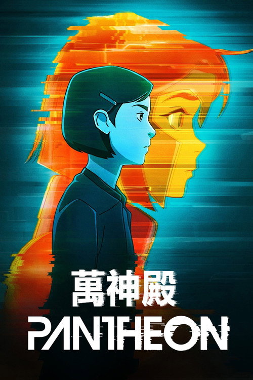
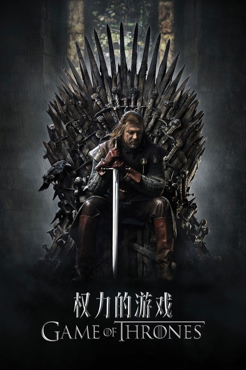
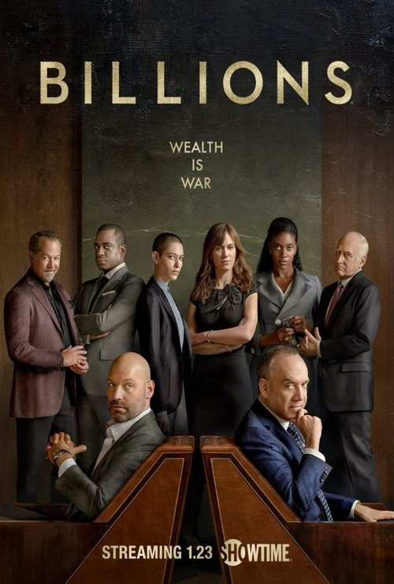
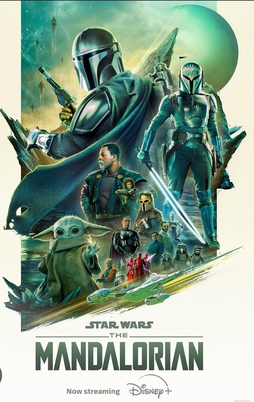

# cinema-log · 观影日志

> 看过的电影电视剧，人物关系图都整理在这里。每部剧有一份**可交互的网页版人物关系图**、一张**关系图长图**和一份**文字版**。

🌐 **在线浏览：https://1990jtf.github.io/cinema-log/**

| 📺 剧集 | 👥 人物 | 🗓️ 跨度 |
| --- | --- | --- |
| **10 部** | **224 位** | 2011–2024 |

---

## 剧集一览

| 海报 | 剧名 | 平台 | 年份 | 季数 | 人物 | 资料 |
| --- | --- | --- | --- | --- | --- | --- |
|  | **继承之战** · Succession<br>★ 8.4 | HBO | 2018–2023 | 4 季 · 已完结 | 23 | [网页版](archive/Succession/%E7%BB%A7%E6%89%BF%E4%B9%8B%E6%88%98%E4%BA%BA%E7%89%A9%E5%85%B3%E7%B3%BB%E5%9B%BE.html) · [长图](archive/Succession/succession-relationship.png) · [文字版](archive/Succession/succession-relationship-text.md) |
|  | **万神殿** · Pantheon<br>★ 8.8 | AMC | 2022–2023 | 2 季 · 已完结 | 23 | [网页版](archive/Pantheon/%E4%B8%87%E7%A5%9E%E6%AE%BF%E4%BA%BA%E7%89%A9%E5%85%B3%E7%B3%BB%E5%9B%BE.html) · [长图](archive/Pantheon/pantheon-relationship.png) · [文字版](archive/Pantheon/pantheon-relationship-text.md) · [选择题测验](archive/Pantheon/%E4%B8%87%E7%A5%9E%E6%AE%BF%E9%80%89%E6%8B%A9%E9%A2%98%E6%B5%8B%E9%AA%8C.html) |
|  | **权利的游戏** · Game of Thrones<br>★ 9.5 | HBO | 2011–2019 | 8 季 · 已完结 | 27 | [网页版](archive/Game-of-Thrones/%E6%9D%83%E5%88%A9%E7%9A%84%E6%B8%B8%E6%88%8F%E4%BA%BA%E7%89%A9%E5%85%B3%E7%B3%BB%E5%9B%BE.html) · [长图](archive/Game-of-Thrones/game-of-thrones-relationship.png) · [文字版](archive/Game-of-Thrones/game-of-thrones-relationship-text.md) |
|  | **硅谷** · Silicon Valley<br>★ 9.1 | HBO | 2014–2019 | 6 季 · 已完结 | 20 | [网页版](archive/Silicon-Valley/%E7%A1%85%E8%B0%B7%E4%BA%BA%E7%89%A9%E5%85%B3%E7%B3%BB%E5%9B%BE.html) · [长图](archive/Silicon-Valley/silicon-valley-relationship.png) · [文字版](archive/Silicon-Valley/silicon-valley-relationship-text.md) |
|  | **纸牌屋** · House of Cards<br>★ 9.3 | Netflix | 2013–2018 | 6 季 · 已完结 | 26 | [网页版](archive/House-of-Cards/%E7%BA%B8%E7%89%8C%E5%B1%8B%E4%BA%BA%E7%89%A9%E5%85%B3%E7%B3%BB%E5%9B%BE.html) · [长图](archive/House-of-Cards/house-of-cards-relationship.png) · [文字版](archive/House-of-Cards/house-of-cards-relationship-text.md) |
|  | **人生切割术** · Severance<br>★ 9.1 | Apple TV+ | 2022– | 已播 2 季 · 追更中 | 20 | [网页版](archive/Severance/%E4%BA%BA%E7%94%9F%E5%88%87%E5%89%B2%E6%9C%AF%E4%BA%BA%E7%89%A9%E5%85%B3%E7%B3%BB%E5%9B%BE.html) · [长图](archive/Severance/severance-relationship.png) · [文字版](archive/Severance/severance-relationship-text.md) |
|  | **亿万** · Billions<br>★ 8.9 | Showtime | 2016–2023 | 7 季 · 已完结 | 22 | [网页版](archive/Billions/%E4%BA%BF%E4%B8%87%E4%BA%BA%E7%89%A9%E5%85%B3%E7%B3%BB%E5%9B%BE.html) · [长图](archive/Billions/billions-relationship.png) · [文字版](archive/Billions/billions-relationship-text.md) |
|  | **黑钱胜地** · Ozark<br>★ 8.4 | Netflix | 2017–2022 | 4 季 · 已完结 | 21 | [网页版](archive/Ozark/%E9%BB%91%E9%92%B1%E8%83%9C%E5%9C%B0%E4%BA%BA%E7%89%A9%E5%85%B3%E7%B3%BB%E5%9B%BE.html) · [长图](archive/Ozark/ozark-relationship.png) · [文字版](archive/Ozark/ozark-relationship-text.md) |
|  | **曼达洛人** · The Mandalorian<br>★ 9.2 | Disney+ | 2019–2023 | 3 季 · 已完结 | 20 | [网页版](archive/Mandalorian/%E6%9B%BC%E8%BE%BE%E6%B4%9B%E4%BA%BA%E4%BA%BA%E7%89%A9%E5%85%B3%E7%B3%BB%E5%9B%BE.html) · [长图](archive/Mandalorian/mandalorian-relationship.png) · [文字版](archive/Mandalorian/mandalorian-relationship-text.md) |
|  | **庆余年** · Joy of Life<br>★ 7.9 | 腾讯视频 | 2019–2024 | 2 季 · 追更中 | 22 | [网页版](archive/Joy-of-Life/%E5%BA%86%E4%BD%99%E5%B9%B4%E4%BA%BA%E7%89%A9%E5%85%B3%E7%B3%BB%E5%9B%BE.html) · [长图](archive/Joy-of-Life/joy-of-life-relationship.png) · [文字版](archive/Joy-of-Life/joy-of-life-relationship-text.md) |

> 豆瓣评分为第一季评分（豆瓣按季打分，无整部剧总分）。

---

## 一句话简介

- **继承之战**（剧情） — 传媒帝国 Roy 家族的继承权争夺，权力的游戏没有赢家。
- **万神殿**（剧情 / 动作 / 科幻 / 动画） — 意识上传成 AI 之后，人还是人吗？
- **权利的游戏**（剧情 / 奇幻 / 冒险） — 七大家族争夺铁王座，凛冬将至。
- **硅谷**（喜剧） — Pied Piper 创业团队的荒诞创业路。
- **纸牌屋**（剧情 / 惊悚） — Frank 与 Claire 的夺权之路，一切为了权力。
- **人生切割术**（剧情 / 科幻 / 悬疑） — 切割手术把人生劈成里外两个人。
- **亿万**（剧情） — 对冲基金大佬与联邦检察官的金钱战争，财富即战争。
- **黑钱胜地**（剧情 / 惊悚 / 犯罪） — 财务顾问为毒枭洗钱，一家人在湖畔小镇越陷越深。
- **曼达洛人**（科幻 / 奇幻） — 赏金猎人与一个孩子的旅程，信条即道路。
- **庆余年**（剧情 / 古装） — 范闲从儋州少年到京都权臣，查身世、斗权贵、揭开叶轻眉之死。

---

## 目录结构

```
cinema-log/
├── index.html          # 首页：海报卡片导航（GitHub Pages 入口），支持搜索、平台与类型筛选
├── favicon.svg         # 网站图标（场记板）
├── README.md           # 本文件
├── shows.json          # 各剧信息：唯一数据源，改这里再跑 tools/sync.py
├── tools/sync.py       # 同步脚本：由 shows.json 生成首页与 README
├── cover/              # 各剧官方海报
├── .nojekyll           # GitHub Pages 配置：不使用 Jekyll
└── archive/            # 各剧资料，每部剧一个文件夹
    ├── Succession/ # 继承之战：网页版 HTML、关系图 PNG、文字版
    ├── Pantheon/ # 万神殿：网页版 HTML、选择题测验、关系图 PNG、文字版
    ├── Game-of-Thrones/ # 权利的游戏：网页版 HTML、关系图 PNG、文字版
    ├── Silicon-Valley/ # 硅谷：网页版 HTML、关系图 PNG、文字版
    ├── House-of-Cards/ # 纸牌屋：网页版 HTML、关系图 PNG、文字版
    ├── Severance/ # 人生切割术：网页版 HTML、关系图 PNG、文字版
    ├── Billions/ # 亿万：网页版 HTML、关系图 PNG、文字版
    ├── Ozark/ # 黑钱胜地：网页版 HTML、关系图 PNG、文字版
    ├── Mandalorian/ # 曼达洛人：网页版 HTML、关系图 PNG、文字版
    └── Joy-of-Life/ # 庆余年：网页版 HTML、关系图 PNG、文字版
```

## 新增一部剧

1. 在 `archive/<新剧>/` 放入网页版 HTML、关系图 PNG、文字版 `.md`，海报放进 `cover/`；
2. 在 `shows.json` 里按已有格式加一行（剧名、平台、年份、季数、人物数、一句话简介、文件名、加入日期、豆瓣评分、类型、追更状态）；
3. 运行 `python3 tools/sync.py`，首页统计数字、卡片、筛选按钮与 README 表格会自动同步；
4. 检查脚本输出的提示，确认没有缺失文件；
5. 提交推送（或告诉 Muse 推送）。
