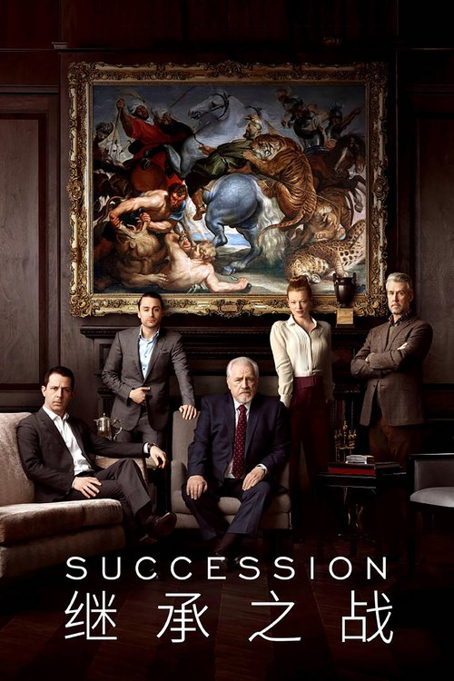
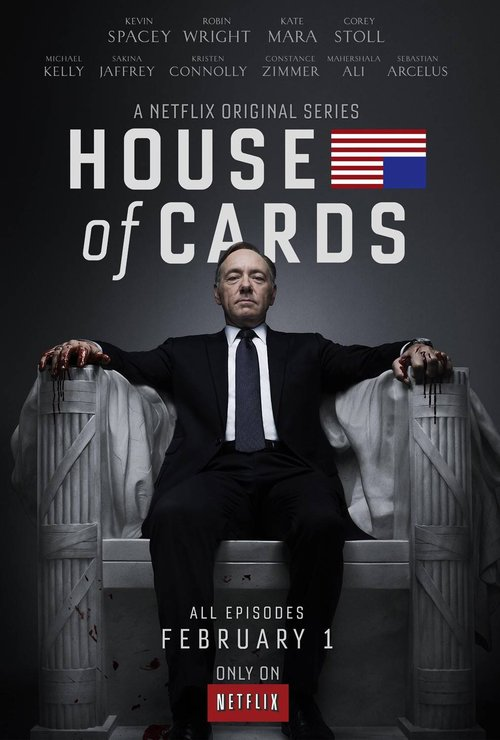
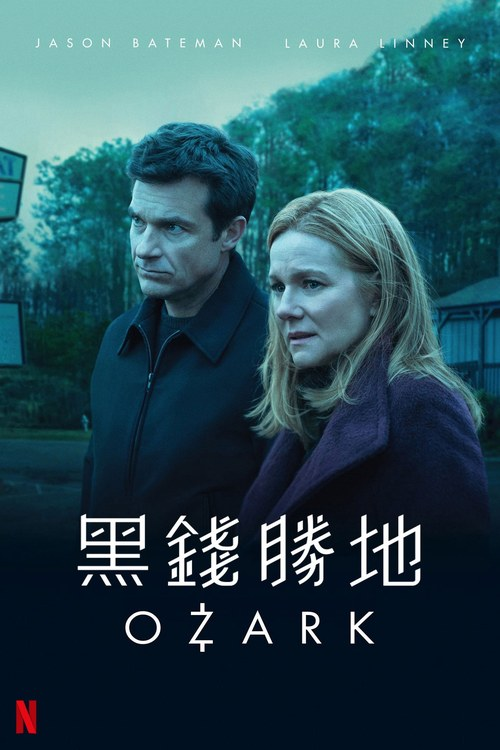

# cinema-log · 观影日志

看过的电影电视剧，人物关系图都整理在这里。每部剧有一份可交互的网页版人物关系图、一张关系图长图和一份文字版。

## 在线浏览

部署后通过一个地址访问全部页面：

**https://1990jtf.github.io/cinema-log/**

首页按海报卡片排列，点海报进入对应剧的人物关系图。也可以直接在仓库里打开 `archive/` 下各剧的 HTML 文件。

---

## 继承之战 · Succession（HBO，2018–2023，4 季）



- **人物：** 23 位
- **网页版：** [继承之战人物关系图](archive/Succession/%E7%BB%A7%E6%89%BF%E4%B9%8B%E6%88%98%E4%BA%BA%E7%89%A9%E5%85%B3%E7%B3%BB%E5%9B%BE.html)
- **关系图长图：** [succession-relationship.png](archive/Succession/succession-relationship.png)
- **文字版：** [succession-relationship-text.md](archive/Succession/succession-relationship-text.md)

传媒帝国 Roy 家族的继承权争夺，权力的游戏没有赢家。

## 万神殿 · Pantheon（AMC，2022–2023，2 季）


- **人物：** 23 位
- **网页版：** [万神殿人物关系图](archive/Pantheon/%E4%B8%87%E7%A5%9E%E6%AE%BF%E4%BA%BA%E7%89%A9%E5%85%B3%E7%B3%BB%E5%9B%BE.html)
- **选择题测验：** [万神殿选择题测验（20 道）](archive/Pantheon/%E4%B8%87%E7%A5%9E%E6%AE%BF%E9%80%89%E6%8B%A9%E9%A2%98%E6%B5%8B%E9%AA%8C.html)
- **关系图长图：** [pantheon-relationship.png](archive/Pantheon/pantheon-relationship.png)
- **文字版：** [pantheon-relationship-text.md](archive/Pantheon/pantheon-relationship-text.md)

意识上传成 AI 之后，人还是人吗？

## 权利的游戏 · Game of Thrones（HBO，2011–2019，8 季）


- **人物：** 27 位
- **网页版：** [权利的游戏人物关系图](archive/Game-of-Thrones/%E6%9D%83%E5%88%A9%E7%9A%84%E6%B8%B8%E6%88%8F%E4%BA%BA%E7%89%A9%E5%85%B3%E7%B3%BB%E5%9B%BE.html)
- **关系图长图：** [game-of-thrones-relationship.png](archive/Game-of-Thrones/game-of-thrones-relationship.png)
- **文字版：** [game-of-thrones-relationship-text.md](archive/Game-of-Thrones/game-of-thrones-relationship-text.md)

七大家族争夺铁王座，凛冬将至。

## 硅谷 · Silicon Valley（HBO，2014–2019，6 季）


- **人物：** 20 位
- **网页版：** [硅谷人物关系图](archive/Silicon-Valley/%E7%A1%85%E8%B0%B7%E4%BA%BA%E7%89%A9%E5%85%B3%E7%B3%BB%E5%9B%BE.html)
- **关系图长图：** [silicon-valley-relationship.png](archive/Silicon-Valley/silicon-valley-relationship.png)
- **文字版：** [silicon-valley-relationship-text.md](archive/Silicon-Valley/silicon-valley-relationship-text.md)

Pied Piper 创业团队的荒诞创业路。

## 纸牌屋 · House of Cards（Netflix，2013–2018，6 季）



- **人物：** 26 位
- **网页版：** [纸牌屋人物关系图](archive/House-of-Cards/%E7%BA%B8%E7%89%8C%E5%B1%8B%E4%BA%BA%E7%89%A9%E5%85%B3%E7%B3%BB%E5%9B%BE.html)
- **关系图长图：** [house-of-cards-relationship.png](archive/House-of-Cards/house-of-cards-relationship.png)
- **文字版：** [house-of-cards-relationship-text.md](archive/House-of-Cards/house-of-cards-relationship-text.md)

Frank 与 Claire 的夺权之路，一切为了权力。

## 人生切割术 · Severance（Apple TV+，2022–，已播 2 季）


- **人物：** 20 位
- **网页版：** [人生切割术人物关系图](archive/Severance/%E4%BA%BA%E7%94%9F%E5%88%87%E5%89%B2%E6%9C%AF%E4%BA%BA%E7%89%A9%E5%85%B3%E7%B3%BB%E5%9B%BE.html)
- **关系图长图：** [severance-relationship.png](archive/Severance/severance-relationship.png)
- **文字版：** [severance-relationship-text.md](archive/Severance/severance-relationship-text.md)

切割手术把人生劈成里外两个人。

## 亿万 · Billions（Showtime，2016–2023，7 季）


- **人物：** 22 位
- **网页版：** [亿万人物关系图](archive/Billions/%E4%BA%BF%E4%B8%87%E4%BA%BA%E7%89%A9%E5%85%B3%E7%B3%BB%E5%9B%BE.html)
- **关系图长图：** [billions-relationship.png](archive/Billions/billions-relationship.png)
- **文字版：** [billions-relationship-text.md](archive/Billions/billions-relationship-text.md)

对冲基金大佬与联邦检察官的金钱战争，财富即战争。

## 黑钱胜地 · Ozark（Netflix，2017–2022，4 季）



- **人物：** 21 位
- **网页版：** [黑钱胜地人物关系图](archive/Ozark/%E9%BB%91%E9%92%B1%E8%83%9C%E5%9C%B0%E4%BA%BA%E7%89%A9%E5%85%B3%E7%B3%BB%E5%9B%BE.html)
- **关系图长图：** [ozark-relationship.png](archive/Ozark/ozark-relationship.png)
- **文字版：** [ozark-relationship-text.md](archive/Ozark/ozark-relationship-text.md)

财务顾问为毒枭洗钱，一家人在湖畔小镇越陷越深。

## 曼达洛人 · The Mandalorian（Disney+，2019–2023，3 季）


- **人物：** 20 位
- **网页版：** [曼达洛人人物关系图](archive/Mandalorian/%E6%9B%BC%E8%BE%BE%E6%B4%9B%E4%BA%BA%E4%BA%BA%E7%89%A9%E5%85%B3%E7%B3%BB%E5%9B%BE.html)
- **关系图长图：** [mandalorian-relationship.png](archive/Mandalorian/mandalorian-relationship.png)
- **文字版：** [mandalorian-relationship-text.md](archive/Mandalorian/mandalorian-relationship-text.md)

赏金猎人与一个孩子的旅程，信条即道路。

---

## 目录结构

```
cinema-log/
├── index.html          # 首页：海报卡片导航（GitHub Pages 入口）
├── README.md           # 本文件
├── cover/              # 各剧官方海报
├── .nojekyll           # GitHub Pages 配置：不使用 Jekyll
└── archive/            # 各剧资料
    ├── Succession/     # 继承之战：网页版 HTML、关系图 PNG、文字版
    ├── Pantheon/       # 万神殿：网页版 HTML、选择题测验、关系图 PNG、文字版
    ├── Game-of-Thrones/# 权利的游戏：网页版 HTML、关系图 PNG、文字版
    ├── Silicon-Valley/ # 硅谷：网页版 HTML、关系图 PNG、文字版
    ├── House-of-Cards/ # 纸牌屋：网页版 HTML、关系图 PNG、文字版
    ├── Severance/      # 人生切割术：网页版 HTML、关系图 PNG、文字版
    ├── Billions/       # 亿万：网页版 HTML、关系图 PNG、文字版
    ├── Ozark/          # 黑钱胜地：网页版 HTML、关系图 PNG、文字版
    └── Mandalorian/    # 曼达洛人：网页版 HTML、关系图 PNG、文字版
```
